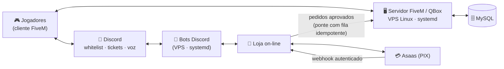

# 🏙️ RADIKAL Roleplay — servidor de GTA V Roleplay (FiveM / QBox)

> **Uma cidade inteira rodando em produção: eu administro o servidor Linux, especifico e testo os sistemas, faço o deploy e atendo os jogadores.**

> 📌 **Este repositório é um estudo de caso, sem código-fonte.** O código é privado porque o servidor está em produção (ver nota no fim).

---

## O que é

O **RADIKAL Roleplay** é um servidor brasileiro de *roleplay* para GTA V, construído sobre o **FiveM** com o framework **QBox (`qbx_core`)**. Os jogadores vivem uma cidade persistente — empregos, facções, economia, polícia, hospital, veículos, moradia — e tudo isso é estado guardado em banco de dados e validado pelo servidor.

Por trás da cidade há um ecossistema completo: o servidor de jogo numa VPS Linux, o banco MySQL, bots de Discord (whitelist, tickets, loja) e uma loja on-line com pagamento via PIX.

## Meu papel

Sou o **dono e administrador** do projeto. Na prática, isso significa:

| Área | O que eu faço |
|---|---|
| 🖥️ **Infraestrutura** | Administro a VPS Linux: serviços no **systemd**, acesso por **SSH**, deploy, rollback, backups, restart controlado, leitura de logs. |
| 🗄️ **Banco de dados** | MySQL via `oxmysql`: tabelas dos sistemas próprios, consultas de diagnóstico, conferência de dados antes e depois de mudanças. |
| 🧪 **Qualidade** | Especifico o comportamento esperado, testo em jogo, rodo suítes de teste e auditorias transversais antes de declarar algo pronto. |
| 🔐 **Segurança** | Defino as regras: servidor como autoridade, limitação de chamadas, logs de auditoria, idempotência em entregas pagas. |
| 🎧 **Suporte** | Atendo jogadores por **tickets** e **canais de voz** no Discord, reproduzo o problema e transformo o relato em diagnóstico. |

## Stack

- **Plataforma de jogo:** FiveM (servidor dedicado de GTA V)
- **Framework:** QBox (`qbx_core`) + bibliotecas **ox** (`ox_lib`, `ox_inventory`, `oxmysql`)
- **Lógica de servidor e cliente:** Lua
- **Interfaces dentro do jogo (NUI):** HTML, CSS e JavaScript
- **Banco de dados:** MySQL / MariaDB (`oxmysql`)
- **Infraestrutura:** VPS Linux, serviços **systemd** (servidor de jogo, bots, site, *watchdogs* com *timer*), SSH
- **Comunidade e suporte:** Discord (bots em Node.js / discord.js: whitelist, tickets, loja)
- **Pagamentos:** Asaas (PIX), com *webhook* processado no lado do servidor

## 📊 Números medidos no código

Medido na cópia local do servidor, na pasta de resources próprios `[radikal]`, contando apenas pastas `radikal_*` que têm `fxmanifest.lua`:

| Métrica | Valor |
|---|---|
| Resources próprios `radikal_*` | **236** |
| … dos quais contêm lógica em Lua | **192** (os demais são pacotes de assets, como 35 skins de arma) |
| Linhas de **Lua** | **≈ 244 mil** (693 arquivos) |
| Linhas de **HTML** (NUI) | ≈ 47,8 mil (85 arquivos) |
| Linhas de **JavaScript** (NUI) | ≈ 27,6 mil (56 arquivos) |
| Linhas de **CSS** (NUI) | ≈ 17,8 mil (47 arquivos) |
| Arquivos de teste/autoteste em Lua | **55**, distribuídos em **22** resources |

**Como medi:** `find` nas pastas `radikal_*` com `fxmanifest.lua`, filtrando por extensão; contagem com `wc -l` bruto (inclui comentários, linhas em branco, configuração e testes). Excluí o próprio `fxmanifest.lua`, arquivos `*.min.*`, `node_modules` e arquivos de backup (`bak`/`old`). Os testes foram contados pelo nome do arquivo (`test`, `teste`, `selftest`). O SQL aparece pouco em arquivo (`.sql`) porque a maior parte das tabelas é criada pelo próprio resource no boot (`CREATE TABLE IF NOT EXISTS`).

> Não publico número de jogadores nem métricas de uso — só o que dá para medir no código.

## 🧩 Sistemas próprios em destaque

| Sistema | O que faz | Ponto técnico |
|---|---|---|
| 🛒 **HUB da cidade + entrega de compras** (`radikal_hub`) | Menu central do jogador; recebe as compras aprovadas na loja on-line e entrega no personagem. | Fila local com **chave única por pedido**: a entrega é idempotente e insiste até dar certo, inclusive para jogador que estava offline. |
| 🎟️ **Passe de Batalha** (`radikal_hub`) | Temporada de 30 dias com trilha grátis e paga, resgate diário. | Tabelas próprias; a **chave primária `(personagem, temporada, dia, trilha)`** impede resgate duplicado — a garantia está no banco, não num `if`. Conteúdo é dado, não código. |
| 🛠️ **Central Admin** (`radikal_admin`) | Painel e comandos de staff. | Comandos validados no servidor, permissões ACE granulares, *cooldown* e **log obrigatório** de cada ação. |
| 📜 **Guard — logs e observabilidade** (`radikal_guard`) | Registro centralizado de eventos sensíveis da cidade. | Sem nenhuma superfície exposta ao cliente: o jogador não consegue alcançá-lo. Logs vindos de relato do cliente são **marcados como tal**. |
| 🚦 **Rate-limit** (`radikal_ratelimit`) | Limitador único de chamadas ao servidor, usado pela cidade inteira via *export*. | Três camadas (teto global, intervalo mínimo e janela) por jogador e por tipo de ação; perfis diferentes para leitura, ação e dinheiro. |
| 🛰️ **Sentinela** (`radikal_sentinela`) | Vigilância do lado do servidor: *heartbeat* e auditoria de eventos de jogo. | Funciona em **modo observador**: coleta evidência antes de punir. |
| ☠️ **Morte com evidência** (`radikal_death`, `radikal_mortes`) | Registro de quem matou quem, arma, hora e local. | Retrato da morte capturado **pelo servidor** no momento da queda — evidência para a staff resolver denúncias. |
| 💳 **Caixa e venda entre jogadores** (`radikal_pay`, `radikal_venda_segura`) | Pagamento central (dinheiro em mão, depois banco) e venda direta de itens. | Transferência atômica com **rollback ordenado para nunca criar item ou dinheiro**; se algo ficar retido, o sistema avisa a staff com todos os dados. |
| 🏴 **Facções e garagem de facção** (`radikal_faccao`, `radikal_garagem_faccao`, `radikal_dominios`) | Painel de facção, cofre, salários, veículos por cargo e guerra de território. | Concessão de veículo **exactly-once** por facção e cargo. |
| 🚚 **Fretes** (`radikal_fretes`) | Emprego de carga pesada: contratos, caminhão, carreta e entrega. | Fluxo inteiro controlado pelo servidor. |
| 🧭 **Onboarding** (`radikal_whitelist`, `radikal_guia`, `radikal_veiculo_inicial`) | Whitelist vinculada ao Discord, central do cidadão com primeiros passos e veículo inicial. | Veículo inicial entregue **uma única vez por personagem**. |
| 💰 **Salário e economia** (`radikal_faccao`, `radikal_economia`) | Salários periódicos de empregos e facções. | Mudanças de economia acompanhadas de suíte de teste dedicada (`radikal_economia_teste`). |

## ⚙️ Operação e confiabilidade

- **Deploy por manifesto, nunca por cópia de pasta.** Antes de qualquer mudança, monto a lista explícita de arquivos que vão subir, gravo backup com **manifesto e hash MD5** e confiro backup × produção. A árvore local tem coisas que não pertencem à produção (backups, segredos, estado gerado em tempo de execução, *bundles* com nome em *hash*) — copiar a pasta inteira levaria tudo junto.
- **A VPS é a referência (baseline).** Antes de planejar uma mudança, meço o estado real do servidor em produção, em vez de confiar em anotação ou na cópia local. No fim do dia, sincronizo produção → cópia local.
- **Rollback preparado antes de agir.** Em mudanças arriscadas, o script de deploy roda desanexado da sessão SSH (uma queda de conexão não deixa o servidor pela metade) e já traz o caminho de volta.
- **Restart controlado.** No FiveM, reiniciar um resource **para os resources que dependem dele e não os religa**. Antes de reiniciar, mapeio a árvore de dependências e confiro no log que tudo que parou voltou a subir.
- **"Ligado" não é "funcionando".** Depois de um deploy, a validação é procurar **erro** no log e reproduzir o comportamento em jogo — não só ver o serviço `active`.
- **Watchdogs em systemd.** Bots críticos (como o que sustenta a whitelist) têm um *timer* que verifica o *heartbeat* periodicamente e age se o serviço parar de responder.
- **Diagnóstico de crash por logs.**
  - Uma série de quedas de cliente foi rastreada até um **pool de memória do jogo com 20 vagas**: cada zona de trânsito controlado ocupa uma. Resultado: um teto documentado e uma regra de adicionar zonas aos poucos, medindo.
  - Correlacionei crashes de cliente com o **orçamento de memória de NPCs e veículos** registrado nos logs do jogo.
  - Fixei a **versão de build** do jogo no servidor e documentei por que o nome do executável no relatório de crash não indica a versão realmente em uso — isso evita investigações falsas.

## 🔐 Segurança

- **O servidor é a autoridade.** Dinheiro, itens, veículos e permissões são decididos e validados no servidor; o cliente só pede.
- **Idempotência em compras pagas.** O gateway de pagamento pode notificar a mesma cobrança mais de uma vez. A proteção contra **entrega dupla** é em camadas:
  - o *webhook* exige autenticação;
  - o pagamento é **relido na fonte**, porque o corpo da notificação só diz qual cobrança consultar;
  - o pedido é processado uma única vez, por ID;
  - o valor pago precisa ser **maior ou igual** ao cobrado;
  - o QR Code PIX é gerado como **pagável uma única vez**.
- **Entrega dentro do jogo também idempotente.** Os pedidos aprovados entram numa fila local com chave única; o jogador nunca recebe em dobro, mesmo que a rede caia no meio.
- **Rate-limit central** em todas as chamadas sensíveis, com perfis por tipo de ação e limpeza quando o jogador sai (um ID reaproveitado não herda a cota de outro jogador).
- **Logs de auditoria** (`radikal_guard`) consumidos por dezenas de resources, sempre chamados de forma protegida: se o log falhar, a operação do jogador não cai junto.
- **Segredos fora do código.** Tokens vêm de configuração privada, nunca são replicados ao cliente nem aparecem em log. Sem token, o serviço **falha fechado**.
- **Princípio de "nunca criar valor".** Rollbacks seguem uma ordem anti-duplicação. Quando algo não pode ser devolvido, fica **retido e reportado** para a staff, em vez de virar brecha para duplicar itens ou dinheiro.

## 🎧 Suporte ao jogador

- **Tickets no Discord:** painel com botão que abre um canal privado entre o jogador e a staff, para dúvidas, denúncias e problemas técnicos.
- **Atendimento por voz:** quando o caso pede, atendo o jogador em canal de voz para reproduzir o problema junto com ele.
- **Do relato ao diagnóstico:** perguntas objetivas (quando, onde, o que apareceu na tela, outros jogadores viram o mesmo?), conferência no log do servidor e na evidência registrada (mortes, transações, ações de admin), e retorno ao jogador com a solução ou o próximo passo.
- **Whitelist e onboarding:** vínculo com o Discord antes da criação do personagem e uma central do cidadão dentro do jogo com regras, primeiros passos e o caminho para o suporte.

## 🗺️ Arquitetura (visão geral)

## 🤝 Como foi construído

Sendo direto: **o código foi escrito com IA como par de programação** (Claude e Codex). O meu trabalho foi o que vem antes e depois do código, que é onde um servidor em produção vive ou morre:

- **Administração** da VPS, do banco e dos serviços;
- **Especificação** do que cada sistema deve fazer e das regras que não podem ser quebradas;
- **Testes em jogo**, suítes de teste e auditorias antes de aceitar uma entrega;
- **Deploy**, rollback e acompanhamento de logs;
- **Suporte** aos jogadores e tradução de relatos em diagnósticos.

Essa rotina é muito próxima do dia a dia de **Suporte / Help Desk**, **SOC** e **QA**: observar logs, desconfiar do "está ligado", reproduzir o problema, isolar a causa, validar a correção e documentar o que foi aprendido.

---

### 🔒 Sobre o código

O código-fonte é **privado por segurança**: o servidor está em produção, e expor a lógica de validação, os fluxos de pagamento e a infraestrutura facilitaria ataques e trapaças. **Posso demonstrar o projeto em entrevista**, com tela compartilhada.
